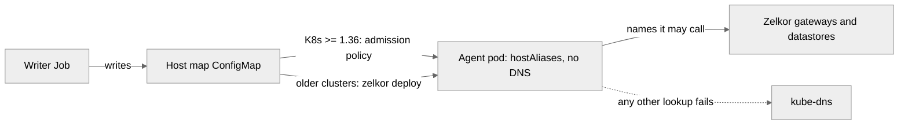

# Run Agents Without DNS

*What you get: agent pods resolve only the platform names they call. Every other lookup fails, so an agent cannot send data out in DNS queries, even past a default-deny NetworkPolicy.*

A NetworkPolicy that blocks agent egress still lets a pod ask kube-dns, and kube-dns forwards any name upstream. A query for `<data>.attacker.example` leaves the cluster, and it never shows up in the gateway or in traces. Zelkor closes that path. Agent pods run with `dnsPolicy: None`, a nameserver that does not answer, and `hostAliases` (entries Kubernetes writes into the pod's `/etc/hosts`) for the platform services they call: the AI Gateway, the MCP gateway, HTTP API routes, and the datastores their profile uses. Port 53 is removed from their egress. All outside names are resolved by the gateway, never by the agent.

Where does an agent pod get its names from?



The lockdown is on by default (`security.dnsLockdown.enabled: true` in the platform chart and in `charts/zelkor-agent`).

## How it is applied

The platform runs a writer Job on every install and upgrade. It writes the host map: a ConfigMap named `<release>-agent-hosts`, with one key per hostname and the live ClusterIP as its value. How the map reaches an agent pod depends on your cluster:

| Cluster | What fills the pod's `hostAliases` | What you do |
| :--- | :--- | :--- |
| Kubernetes 1.36 or newer | A `MutatingAdmissionPolicy` that the chart renders only when the API server serves `admissionregistration.k8s.io/v1/MutatingAdmissionPolicy`. It locks each new agent pod of this platform. | Nothing. A pod you delete is recreated with fresh entries. |
| Older than 1.36 | `zelkor deploy`, which reads the map and writes the entries into the agent's Deployment. | Deploy agents with `zelkor deploy`, and run it again after a platform change moves a Service. |

The admission policy and its binding are cluster-scoped objects. Installing the platform on 1.36 or newer therefore needs rights to create `MutatingAdmissionPolicy` and `MutatingAdmissionPolicyBinding`, which usually means cluster-admin; without them the Helm install is refused. On older clusters the chart renders no admission policy, so namespace-scoped rights are enough.

A pod that is not locked keeps working DNS: it is never half-locked. That covers an agent installed with plain `helm install` on a cluster older than 1.36 and without `platform.hostAliases`. Such a pod is annotated `zelkor.io/dns-lockdown: inactive`.

### The platform Aegra

Aegra is the platform's own agent server, the front door that runs graphs registered on the platform. It is locked too (`security.dnsLockdown.aegra: true`):

- **1.36 or newer:** the admission policy locks it.
- **Older clusters:** the chart reads the host map with Helm `lookup` at upgrade time. The first install keeps DNS, and Aegra is locked from the next `helm upgrade`.
- **GitOps on clusters older than 1.36:** a tool that renders with `helm template` (Argo CD, for example) gets no result from `lookup`, so the platform Aegra is never locked. Use 1.36 or newer, or a tool that runs a real `helm upgrade` against the cluster (Flux's helm-controller does).

## Check that agents are locked

```bash
zelkor verify <platform-release> --hosts
```

Each line is `PASS`, `FAIL` or `WARN`:

| Line | Meaning | Fix |
| :--- | :--- | :--- |
| `PASS host map` | The map still points at the live Service IP | — |
| `FAIL host map ... (live: ...)` | A Service was recreated with a new IP | `helm upgrade` the platform; it rewrites the map |
| `PASS pod hosts` | A locked pod carries exactly the map's entries | — |
| `FAIL pod hosts ... differs on ...` | A locked pod has stale entries | Delete the pod (1.36+) or run `zelkor deploy` |
| `WARN dns ... keeps DNS (no CE-21 lockdown marker ...)` | The agent was deployed before the lockdown existed | Run `zelkor deploy` for it (or delete the pod on 1.36+) |
| `WARN dns ... (lockdown inactive)` | Plain Helm install on a cluster older than 1.36 | Run `zelkor deploy` for it |
| `WARN dns ... did not lock it` | The pod was created before the admission policy loaded | Delete the pod |
| `FAIL http api ...` | An agent relays to an HTTP API the platform no longer routes | Redeploy the agent, or add the API back |
| `FAIL contract ...` | The CLI could not read the platform (connection, RBAC) | Fix access and run it again |

The summary line counts the pods that can still resolve DNS. Warnings do not fail the check. Fix them before you rely on the lockdown.

When a locked agent's sidecar cannot reach a name it needs, it logs one `upstream_unreachable` error with the name and IP and fails readiness. Run `zelkor deploy` for that agent.

## Opt out

Turn the lockdown off only for a workload that must resolve names outside the platform.

| Scope | Setting |
| :--- | :--- |
| One agent (for example, it talks to its own external database) | `security.dnsLockdown.enabled: false` in that agent's values |
| The platform Aegra only (platform graphs that resolve outside names) | `security.dnsLockdown.aegra: false` in the platform values |
| Everything | `security.dnsLockdown.enabled: false` in the platform values |

Sandbox workers are not affected by these settings. They already have no egress at all.

## Known limitation: first install on 1.36

On a fresh install on Kubernetes 1.36 or newer, the platform Aegra pod and the admission policy are created in the same apply. If the pod is created before the API server has loaded the policy, the pod keeps DNS until it is recreated. `zelkor verify --hosts` shows it as `WARN dns ... did not lock it`. Delete it once after the install:

```bash
kubectl -n <platform-namespace> delete pod -l app.kubernetes.io/component=aegra,zelkor.io/dns-lockdown=requested
```

## Related

- [Deploy an agent](agent-deploy.md): `zelkor deploy` fills the agent's host entries on clusters older than 1.36.
- [Call HTTP APIs without giving agents the key](http-apis.md): HTTP API routes are part of the host map.
- [Verify a release](security/verify-release.md): the `egress-dns` row of the fail-closed matrix is proven by these pods.
