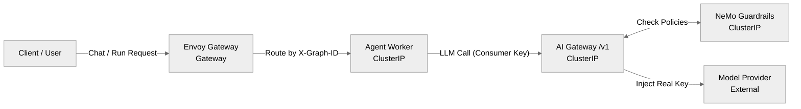

# Request Path

This page details how an external chat or run request flows through Zelkor to the agent, and how the agent reaches the model provider. 

The core advantage is enforced on this path: **the self-hosted agent runtime** runs the agent you already wrote while provider keys, prompt verification, and rate limits stay on the gateway.

*How a client call reaches the model: The call is routed to the agent, which then makes an intercepted call through the AI Gateway.*


## The Boundary

You deploy the **Agent** and configure the **Model**. The platform generates the **Envoy HTTPRoutes**, the **AI Gateway intercept**, and the **NeMo policies**.

The agent is never given the real provider key (e.g., your actual OpenAI API key). It is injected with a local consumer key (`OPENAI_API_KEY`) and its traffic is forced to `OPENAI_BASE_URL` pointing at the internal AI Gateway. 

The AI Gateway applies a **global request cap** on `/v1` (chart default 50 requests per minute). Over the cap, the gateway returns HTTP 429 and does not call the provider — so a looping agent cannot run an unbounded bill. That cap is a request count shared by the install, not a dollar budget. **Pro** adds per-team USD and token ceilings with model downshift on the same path. The gateway also applies guardrails via NeMo, injects the real provider credentials from a Kubernetes Secret, and forwards allowed requests to the upstream model provider.

[//]: # (zelkor-proof vanishing-key begin)
### Proof: No provider key on the agent pod

**Problem.** When an agent framework or dependency is compromised, the first thing an attacker reads is the LLM provider API key in the pod environment.

**Where it holds.** Agent → sidecar → AI Gateway. The agent container holds a placeholder key; the real provider key is injected by the AI Gateway from a Kubernetes Secret.

```bash
$ kubectl -n zelkor exec <agent-pod> -c agent -- env | grep -iE 'openai|anthropic|api_key'
$ kubectl -n zelkor exec <agent-pod> -c agent -- env | grep -iE 'sk-[a-z0-9]{20}|anthropic-'; echo exit=$?
$ kubectl -n zelkor exec <agent-pod> -c sidecar -- env | grep -iE 'sk-[a-z0-9]{20}|anthropic-'; echo exit=$?
$ kubectl -n zelkor get secret zelkor-platform-ai-gateway-consumer -o name
$ zelkor run --graph-id rt-pydantic --input 'What is 6 multiplied by 7? Answer with just the number.'
```

**Result.** The agent container shows only `OPENAI_BASE_URL=http://127.0.0.1:8001/run/active/v1` and `OPENAI_API_KEY=via-sidecar`. Neither container matches a provider key pattern (`exit=1`). The `examples/runtimes/pydantic-ai` sample (`rt-pydantic`) still answered `42` through the gateway, with one Langfuse trace and no error observations.

Every command exited 0 on a lab cluster running chart `2.4.3` on 2026-11-08. Security promises: Observability, Model Gateway, Network Isolation ([threat model](threat-model.md#_3-security-promises-ce)).

[//]: # (zelkor-proof vanishing-key end)

## Hop by hop

| Hop | From → to | What holds the boundary |
| :--- | :--- | :--- |
| 1 | Client → Envoy Gateway | Tenant JWT verified; routed to the agent by `X-Graph-ID` |
| 2 | Envoy Gateway → agent pod | ClusterIP only; the agent is not published on its own |
| 3 | Agent → AI Gateway `/v1` | `OPENAI_BASE_URL` points here; `OPENAI_API_KEY` is a gateway consumer key. The agent pod holds no provider key |
| 4 | AI Gateway ↔ NeMo Guardrails | Input and output checks before and after the model call |
| 5 | AI Gateway → model provider | Real key injected from a Kubernetes Secret. One install-wide bucket (default 50 requests per minute) counts provider calls; over it, HTTP 429 and no provider call |
