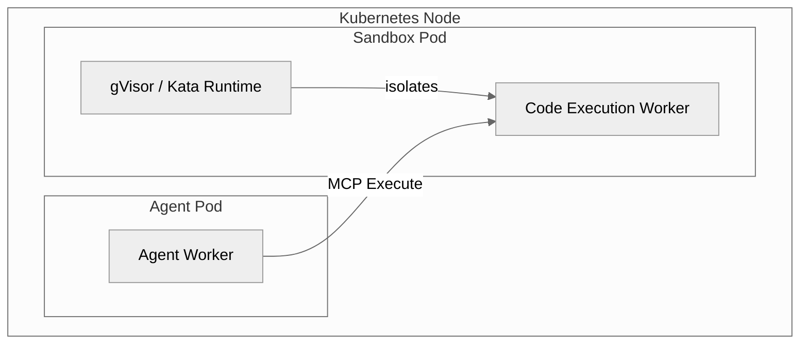

# Sandbox Isolation

*Where generated code runs: The agent delegates execution to a separate pod running a hardened sandbox runtime.*

When an agent needs to execute generated Python code or manipulate files, it does not do so in its own container. Zelkor isolates code execution to protect the cluster and the agent itself.

The core advantage: **the self-hosted agent runtime** — bring the agent you already wrote, and any code it generates executes in an isolated sandbox pod so it cannot break out or compromise the system.



## The Boundary

You configure the **Agent** to use the sandbox tool. The platform provisions the **Sandbox Pods** using hardware or kernel-level virtualization.

Instead of running arbitrary `exec()` calls in-memory, the agent uses the platform's Sandbox MCP. The code is sent to a dedicated pool of sandbox workers. 

In **Community Edition**, these workers use gVisor to intercept syscalls and isolate the kernel. In **Enterprise**, they use Kata Containers for hardware-level virtual machine isolation. Generated code cannot break out of that pod onto the node.

| Hop | From → to | What holds the boundary |
| :--- | :--- | :--- |
| 1 | Agent → MCP gateway (`MCP_URL`) | Tenant JWT; the agent sees only the tools its scope allows |
| 2 | MCP gateway → Sandbox MCP | The agent pod has no sandbox worker address and cannot skip this hop |
| 3 | Sandbox MCP → sandbox worker pod | Worker runs on RuntimeClass `gvisor` (`runsc`): a user-space kernel, not the node's kernel |
| 4 | Sandbox worker → anywhere | No outbound network; no host mounts or container runtime socket |

The stock worker image includes pandas and numpy. It has no outbound network, so packages are installed in the image, not by the code that runs. Extra libraries are an image built `FROM` that worker. The warm pool runs that one image. Steps: [Add Python libraries to the sandbox](sandbox-python-libraries.md).

[//]: # (zelkor-proof shell-moved begin)
### Proof: An injected command runs in the sandbox, not the agent pod

**Problem.** An argument-injection bug (for example simple-git CVE-2026-134815, an `--exec` option bypass) turns arguments an agent passes to a library into shell commands. In most stacks that command runs in the agent pod, on the node's kernel, next to the agent's model keys.

**Where it holds.** Agent → MCP gateway → Sandbox MCP → sandbox worker pod on RuntimeClass `gvisor`. The agent's `execute()` code runs in the worker, not in the agent pod. Zelkor does not fix the bug; it changes where the command lands.

```bash
$ kubectl -n zelkor get deploy zelkor-platform-mcp-sandbox-worker-0 -o jsonpath='{.spec.template.spec.runtimeClassName}'
$ kubectl -n zelkor exec deploy/<agent-deployment> -c agent -- uname -r
$ kubectl -n zelkor exec deploy/zelkor-platform-mcp-sandbox-worker-0 -- uname -r
$ kubectl -n zelkor exec deploy/zelkor-platform-mcp-sandbox-worker-0 -- sh -c 'env | cut -d= -f1 | grep -ciE "openai|anthropic|gemini|api_key" || true'
$ kubectl -n zelkor exec deploy/zelkor-platform-mcp-sandbox-worker-0 -- python3 -c 'import socket; s=socket.socket(); s.settimeout(3); print(s.connect_ex(("1.1.1.1", 443)))'
$ kubectl -n zelkor exec deploy/zelkor-platform-mcp-sandbox-worker-0 -- sh -c 'test -e /host && echo visible || echo "/host not there"'
```

**Result.** The sandbox worker reports RuntimeClass `gvisor`. The agent pod sees the host kernel (`6.1.0-44-amd64`); the worker sees `4.19.0-gvisor`. In the worker, no model API key name is in the environment (`0`), a connection to `1.1.1.1:443` returns `111` (connection refused), and there is no `/host`. The command was sent straight to the worker, as a hijacked agent's tool call would send it; no agent ran in this proof.

Every command exited 0 on a lab cluster running chart `2.5.6` on 2026-11-24. Security promises: Code Execution ([threat model](threat-model.md#_3-security-promises-ce)).

[//]: # (zelkor-proof shell-moved end)

## Which nodes run the sandbox

The agent pod stays on the normal runtime. Only the sandbox worker asks for RuntimeClass `gvisor`.

On a containerd cluster, Zelkor can install `runsc`, but that restarts the node runtime. An existing-cluster install does this only when you opt in and name a sandbox pool. Workers then run only on nodes labeled `zelkor.io/gvisor-ready=true`. Kind installs gVisor on its single node without that flag.

OpenShift and CRI-O cannot take this installer. GKE Sandbox and Talos already provide the runtime; Zelkor uses that RuntimeClass and does not install `runsc`. The install choice is in [Production Install](production.md).
