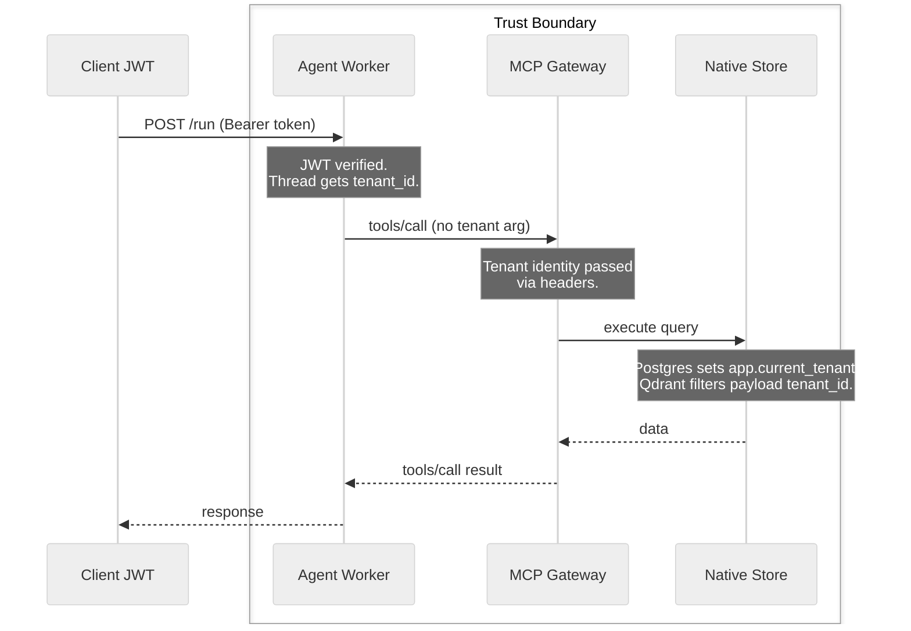
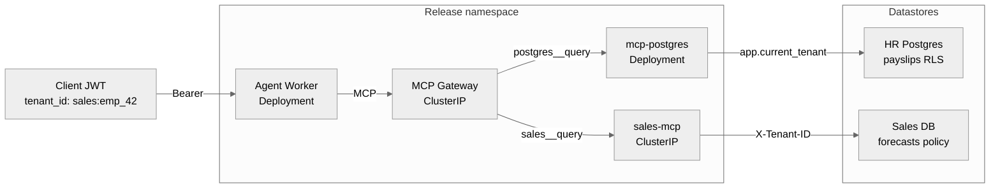

# Tenant Isolation

A **tenant** is the logical boundary for data and access. Depending on your business, a tenant might be a customer organization (`Acme_Corp`, `Bank_Alpha`) in a B2B platform, an internal department (`HR`, `Engineering`) in an enterprise tool, or an individual user (`user_123`) in a B2C app.

Zelkor isolates these tenants across the platform. One verified identity scopes the run, the tools, and the trace. The agent cannot choose a different tenant. Another tenant’s rows, vectors, and traces are not reachable from this run.

The core advantage: **the self-hosted agent runtime** — bring the agent you already wrote; it can't break out, reach unauthorized data or networks, its prompts are verified, budget controlled, and it is under observation.

* **Community Edition** is the self-hosted runtime.
* **Pro** adds SSO, team controls (budgets and approvals), and team GitOps.
* **Enterprise** adds isolation and compliance on Pro (hardware sandbox, mTLS, retained audit, BAA).

*How a tenant identity scopes a run. The agent code never supplies the `tenant_id` to the tools; it is enforced by the platform.*


## One Identity Per Run

The platform extracts the tenant identity from a verified JWT at the front door. This identity is injected into the agent worker's thread state. The agent code does not parse the token, and it cannot forge a different identity.

**No Default Tenant:** To ensure strict isolation, Zelkor does not have a "default" or "fallback" tenant. If a request lacks a valid JWT, or if the token is missing the required tenant claim, the platform fails closed and rejects the request. There is no global tenant that can access all data.

## Tool Governance

When the agent calls a tool via the Model Context Protocol (MCP), it cannot pass a `tenant_id` argument. If an agent tries to supply one, the `tools/call` request fails closed. The MCP Gateway receives the tenant identity from the platform's internal headers, ensuring the agent cannot spoof another tenant.

## Native Store Filtering

Native MCP servers (like Postgres and Qdrant) apply this tenant identity directly to their queries. 
- In **Postgres**, each call sets `app.current_tenant` to the verified tenant. The server does not rewrite the SQL. Row-level security applies only when your policies read that setting.
- In **Qdrant**, search and scroll filter on payload `tenant_id`. Upsert stamps that field from the verified tenant.

Extra MCP backends (Bring Your Own) receive the tenant identity in headers but are responsible for applying their own filters (see [Extra Backends](mcp-extra-backends.md)).

## Langfuse Tracing

Every run trace emitted to Langfuse is tagged with the user identity derived from the JWT. Traces are naturally partitioned, and one tenant cannot query or view traces belonging to another.

## Department and User Boundaries Across Databases

In an internal enterprise deployment, a single boundary is rarely enough:

- **Department (`hr`, `sales`)** decides which database an agent may query and whether a caller sees all rows in that department.
- **User (`emp_42`)** owns the conversation thread, the Langfuse trace, and self-service rows (such as an employee viewing their own payslip in HR while HR staff view all employees, and neither HR nor normal employees outside Sales can read Sales forecasts).

If you set the Zelkor tenant to the department (`hr` or `sales`), every employee in that department shares the same `tenant_id` and can read each other's chat threads. Instead, keep the **individual user (or composite `dept:user`) as the verified tenant identity**, expose each database as its own MCP tool prefix (`postgres__*` for the native store, `sales__*` via [Register Extra MCP Backends](mcp-extra-backends.md)), and enforce the department vs. user split in the database policy.

*How a composite `dept:user` identity isolates chat threads per employee while enforcing department-wide and self-service rules across two databases.*


### Example: Postgres RLS for HR Payslips vs. Sales Forecasts

With `tenant_id` formatted as `<dept>:<employee_id>` (for example `sales:emp_42` or `hr:emp_99`), `zelkor-postgres-mcp` sets `SET LOCAL app.current_tenant = 'sales:emp_42'` on the transaction. PostgreSQL Row-Level Security (RLS) splits that setting into department and user without changing the agent code:

```sql
ALTER TABLE payslips ENABLE ROW LEVEL SECURITY;

CREATE POLICY payslip_isolation ON payslips
  USING (
    split_part(current_setting('app.current_tenant', true), ':', 1) = 'hr'
    OR employee_id = split_part(current_setting('app.current_tenant', true), ':', 2)
  );
```

For a separate Sales database (or a second schema), the policy checks only the department prefix:

```sql
ALTER TABLE forecasts ENABLE ROW LEVEL SECURITY;

CREATE POLICY sales_forecasts_isolation ON forecasts
  USING (
    split_part(current_setting('app.current_tenant', true), ':', 1) = 'sales'
  );
```

| Caller | Verified `tenant_id` | Thread & Trace Owner | HR `payslips` (`postgres__query`) | Sales `forecasts` (`sales__query`) |
| :--- | :--- | :--- | :--- | :--- |
| **Sales employee** | `sales:emp_42` | `sales:emp_42` (private) | Own row only (`employee_id = 'emp_42'`) | All sales rows (`dept = 'sales'`) |
| **HR specialist** | `hr:emp_99` | `hr:emp_99` (private) | All employee rows (`dept = 'hr'`) | **0 rows** (`dept != 'sales'`) |

### Non-Postgres Databases (Oracle, SQL Server, MongoDB)

When the second database is not PostgreSQL, register a thin MCP server for it under `workspace.tools.extraBackends` ([Register Extra MCP Backends](mcp-extra-backends.md)) and apply the same verified `X-Tenant-ID` header at the storage layer:

- **Engines with session-level RLS (SQL Server, Oracle):** Set the session context from `X-Tenant-ID` before running `SELECT` (`EXEC sp_set_session_context @key=N'tenant_id', @value=..., @read_only=1` on SQL Server; `DBMS_SESSION.SET_IDENTIFIER(...)` with a VPD policy on Oracle, cleared when the connection returns to the pool).
- **Document and key-value stores without engine RLS (MongoDB, Qdrant, S3):** Never expose raw query evaluation (`$where`, `$function`, unrestricted `runCommand`). The MCP wrapper parses `X-Tenant-ID` and wraps the caller's filter in `{"$and": [agent_filter, enforced_tenant_filter]}` in code, matching how native `zelkor-qdrant-mcp` stamps `payload.tenant_id`.

