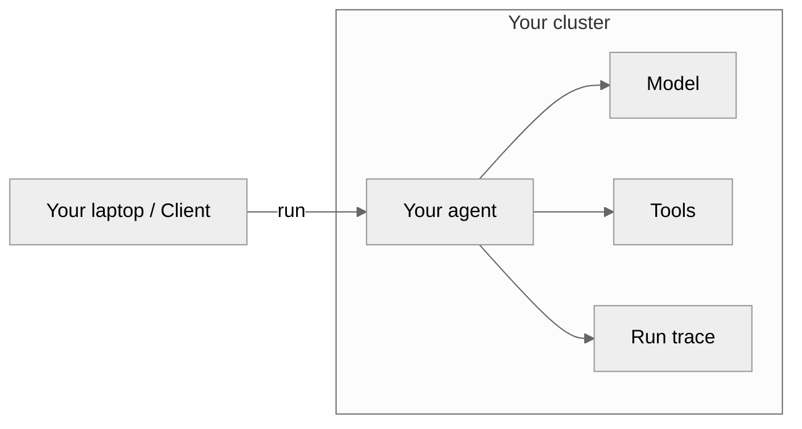

# Architecture Hub

*High-level flow: You deploy an agent. It communicates strictly through governed model and tool gateways, emitting a trace.*

Zelkor is **the self-hosted agent runtime**: bring the agent you already wrote — it cannot break out, reach unauthorized data or networks, its prompts are verified, budget controlled, and it is under observation; tenants stay isolated.

This hub maps the hops and boundaries that the runtime enforces.

## Zelkor vs a DIY agent stack

The DIY baseline is a raw Deployment per agent, LiteLLM or direct provider SDKs, and hand-written NetworkPolicies.

| Concern | DIY: what you build and keep working | Typical DIY failure | Zelkor CE (one Helm release) |
| :--- | :--- | :--- | :--- |
| Provider keys | A Secret mounted into each agent pod | A compromised agent or dependency reads the key | Key stays on the AI Gateway; the agent gets a consumer key ([Request Path](architecture-request-path.md)) |
| Runaway cost | Per-agent retry and loop limits in code | A loop runs overnight against the provider | Gateway request cap returns 429 before the provider |
| Generated code | `exec()` in the agent container, or a separate sandbox you wire in | Code runs on the node kernel next to the agent's credentials | Separate gVisor worker pod with no network ([Sandbox Isolation](architecture-sandbox.md)) |
| Egress | NetworkPolicies per agent and per datastore | One missing rule lets the agent reach the internet or Postgres | Generated per agent by the chart; on in the production install ([Network Boundaries](architecture-network.md)) |
| Tools | Credentials and tenant filters in each tool server | The model chooses the tenant or scope | One MCP gateway; scope from the signed tenant JWT ([MCP Governance](architecture-mcp.md)) |
| Traces | OTel wiring per framework | Tool and guardrail spans missing from the run | One Langfuse trace per run ([Run Trace](architecture-trace.md)) |
| Tenants | Tenant checks in agent code | One tenant reads another's thread or rows | Enforced at the gateways ([Tenant Isolation](architecture-tenants.md)) |

## Deep Dives

Each page answers one specific architectural question about how traffic flows and where the trust boundaries lie:

| Page | Question |
| :--- | :--- |
| [Request Path](architecture-request-path.md) | How a client call reaches the model |
| [Network Boundaries](architecture-network.md) | Who may talk to whom inside the cluster |
| [Sandbox Isolation](architecture-sandbox.md) | Where generated code executes |
| [MCP Governance](architecture-mcp.md) | How a tool call is isolated and authenticated |
| [External and Third-Party MCP](architecture-external-mcp.md) | How Zelkor isolates and governs third-party SaaS and external MCP servers |
| [Run Trace](architecture-trace.md) | What one run looks like in Langfuse |
| [North-South Exposure](architecture-exposure.md) | What is published to the internet versus ClusterIP |
| [Envoy Graph Routing](architecture-routing.md) | How Envoy routes incoming calls to the correct agent deployment |
| [Drop-In Agent Contract](architecture-agent-contract.md) | How the runtime wraps and governs your agent (Intercept, Wrap, MCP) |
| [Tenant Isolation](architecture-tenants.md) | How one tenant identity is applied on a run |
| [Agent Datastores](architecture-datastores.md) | Stateful infrastructure (Postgres, Qdrant) and BYO options |
