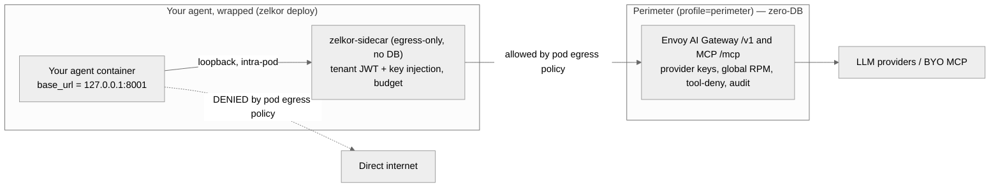
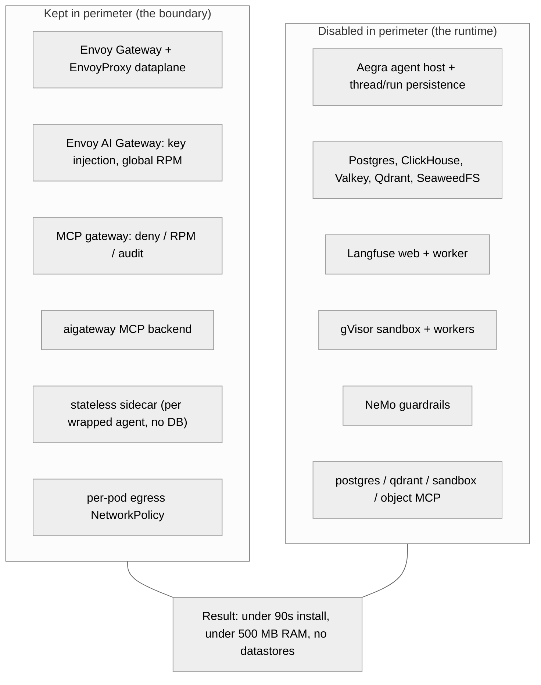
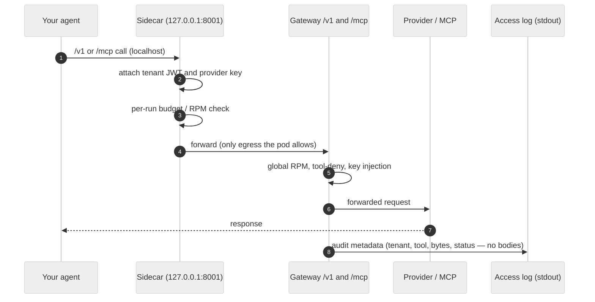

# Perimeter Profile

*What it is: the Zelkor armor around an agent's outbound calls, with none of the runtime — no datastores, no agent host, no trace store.*

`profile=perimeter` installs a **zero-database egress boundary** for your agents' LLM and MCP traffic. It has two parts:

1. **The gateway** — a shared Envoy AI Gateway (`/v1`) and MCP gateway (`/mcp`) that inject provider keys, rate-limit, deny mutating tools, and log audit metadata. Installs in under 90 seconds and under 500 MB of RAM.
2. **A stateless sidecar** — the same `zelkor-sidecar` the full runtime uses, minus its database. You wrap an agent with `zelkor deploy`, and the sidecar forces that agent's LLM and MCP calls through the gateway, attaches its tenant identity and keys, and meters it — with nothing stateful behind it.

Use it when your agents run on Kubernetes and you want to **armor their outbound calls** without adopting the full runtime (no Postgres, ClickHouse, Valkey, Qdrant, SeaweedFS, Langfuse, agent host, sandbox, or guardrails).

## Why a gateway alone is not enough

A gateway only controls traffic that is routed to it, and a Kubernetes NetworkPolicy only governs pods in its own namespace. The perimeter gateway cannot, by itself, stop an agent in another namespace from calling an LLM provider directly. Enforcement has to live **where the agent runs**. The perimeter does that by wrapping the agent with a stateless sidecar in the same pod and locking that pod's egress to the gateway.

## How it works



The sidecar runs in the agent's pod. The agent talks to `127.0.0.1:8001`; the sidecar is the only thing allowed to leave the pod, and only to the gateway. A hardcoded `api.openai.com` call is dropped by the pod's egress NetworkPolicy. The agent never holds provider keys and cannot assume another tenant — the sidecar stamps both.

## What it deploys versus the full profile



The sidecar's footprint lives in your agent's pod, not in the perimeter install — so the gateway stays under 500 MB and zero-DB no matter how many agents you wrap.

## What happens to a request



## Install

Install the gateway once on any cluster (supply at least one provider credential and a hostname):

```bash
helm upgrade --install zelkor-platform charts/zelkor-platform \
  --set profile=perimeter \
  --set workspace.models.providers.openai.apiKey=sk-... \
  --set gateway.hosts.aiGateway=ai-gateway.example.com
```

Laptop `kind`:

```bash
OPENAI_API_KEY=sk-... ./install.sh --profile=perimeter
```

Then wrap an agent so its egress is forced through the gateway. `--egress-only` runs the agent behind a stateless (no-database) sidecar and locks the pod's egress to the gateway; name the MCP tools it may use (or `--all-tools`):

```bash
zelkor deploy my-agent --egress-only --tools postgres,sandbox
```

The installer skips the datastore, Langfuse, agent, and demo phases and does not install gVisor, so a perimeter install is a fraction of a full install.

## Agents you do not wrap

If an agent is not wrapped by `zelkor deploy` — for example a black-box workload, or an agent in another cluster — the gateway becomes an **opt-in proxy**: it enforces key injection, rate limits, tool-deny, and audit on traffic sent to it, but nothing compels that agent to use it. To make egress mandatory for such workloads, apply a default-deny-egress NetworkPolicy to their namespace (allow egress only to the gateway Service and DNS), or use a cluster egress firewall. See [Network Isolation](architecture-network.md).

## Observability

The database is off, so there is no Langfuse trace UI — but the gateway still reports **per-request token usage** to stdout as structured JSON. Every `/v1` call emits an `llm_access` log line with the tenant, model, input / output / total token counts, response code, and timing — never prompt or completion bodies. Scrape it from pod logs or your existing log pipeline to track usage and cost without a datastore.

## What it does not include

Because the perimeter is zero-database, these are off by design:

- **No trace UI.** Langfuse is off, so there is no waterfall view. The gateway still emits the `llm_access` token log and MCP audit metadata to stdout (see [Observability](#observability)).
- **No in-cluster agent host and no persistence.** The stateless sidecar armors egress but does not persist threads or runs. For durable run history and the trace UI, use the full profile.
- **No code sandbox and no guardrails.** gVisor and NeMo are off to hold the memory budget.

When you need any of the above, install the full profile (the default) — it is the same gateway and sidecar with the persistence, trace, sandbox, and guardrail planes turned on. See [Helm Install](helm-install.md) and [Local Quickstart](quickstart.md).
