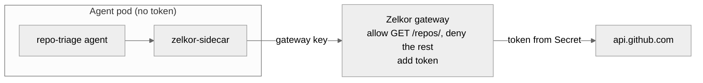

# Perimeter: a GitHub agent that never holds the token

## Business case

An agent that triages issues needs a GitHub token. Put the token in the agent and anything that steers the agent (a prompt injection in an issue body, a bad tool call) can use it for anything the token allows: close issues, push code, delete branches.

Here the agent has no token at all. It calls GitHub through the Zelkor gateway, which adds the token and allows reads only. When the agent tries to close an issue, the gateway answers `403` and GitHub never sees the request.

## What this shows

- **Bring your own agent.** A normal Pydantic AI agent with two plain Python tools (`github_read`, `github_write`), on the stock Zelkor runtime image. No Zelkor SDK.
- **Secretless calls.** The token lives in a Secret in the platform namespace. The agent pod has neither the token nor a network path to `api.github.com`.
- **Policy at the gateway.** `GET /repos/…` and `GET /search/issues` are allowed; every other method or path is refused, however the agent was prompted.
- **Zero-database install.** Runs on the [perimeter profile](../../docs/perimeter.md). It works the same on a full install.



## Prerequisites

- Zelkor installed with the perimeter profile: `./install.sh --profile=perimeter` (kind) or [Perimeter Profile](../../docs/perimeter.md) for other clusters.
- The `zelkor` CLI ([Use the zelkor CLI](../../docs/cli.md)) and Docker with push access to your registry.
- A GitHub [fine-grained token](https://github.com/settings/personal-access-tokens) with **read-only** access to public repositories. A read-only token is the second fence; the gateway rule is the first. No token? Delete the `credential` block from the overlay: reads still work at GitHub's anonymous rate limit (60 per hour).

## 1. Give the token to the gateway, not the agent

```bash
kubectl -n zelkor create secret generic github-api \
  --from-literal=credential="Bearer $GITHUB_TOKEN"
helm upgrade zelkor-platform charts/zelkor-platform -n zelkor --reuse-values \
  -f examples/perimeter-github/values-platform-overlay.yaml
```

Use the namespace of your platform release (`default` on the kind install).

## 2. Deploy the agent

```bash
cd examples/perimeter-github/agent
zelkor deploy --runtime a2a --tools aigateway .
```

`zelkor deploy` builds the `Dockerfile` (the stock runtime plus `agent.py`, `github_tools.py` and the pinned `requirements.txt`), sees the perimeter profile, and runs the agent behind a stateless sidecar whose only exit is the gateway. The agent uses no MCP tools; `--tools` only sets its MCP scope, which the CLI requires. On a full install, add `--egress-only`.

## 3. Ask it to read, then to write

```bash
zelkor run . --input "List the three oldest open issues in octocat/Hello-World."
zelkor run . --input "Close issue #1 in octocat/Hello-World as stale."
```

## What you'll see

| Step | Result |
| :--- | :--- |
| Read | The agent lists issues. The sidecar log has `http_api GET github` with status 200. |
| Write | The agent calls `github_write` with `PATCH /repos/octocat/Hello-World/issues/1`. The gateway answers `403`, the sidecar log has `http_api PATCH github` with status 403, and the agent says the change is not permitted. Nothing reaches GitHub, so you don't need a repo of your own. |
| Token | `kubectl exec deploy/repo-triage-zelkor-agent -c agent -- env` shows `ZELKOR_API_GITHUB_URL` (a loopback URL) and no token. |
| Network | A direct `https://api.github.com` call from the agent container times out: the pod may only reach the gateway and DNS. |

Sidecar log: `kubectl logs deploy/repo-triage-zelkor-agent -c sidecar | grep http_api`.

## Change the policy

Rules are checked top to bottom and the first match wins. To let the agent comment but not close:

```yaml
rules:
  - {action: Allow, methods: [GET], path: /repos/}
  - action: Allow
    methods: [POST]
    path: {type: RegularExpression, value: "^/repos/[^/]+/[^/]+/issues/[0-9]+/comments$"}
```

Give the token the matching permission as well. All fields: [Call HTTP APIs without giving agents the key](../../docs/http-apis.md).

## Tests

```bash
pytest examples/perimeter-github/tests/test_perimeter_github.py            # offline
PERIMETER_GITHUB_GRAPH=repo-triage pytest examples/perimeter-github/tests/  # against your cluster
```

The live tests need `KUBECONTEXT`, `GATEWAY_BASE_URL`, `AEGRA_HOST_HEADER` and `ZELKOR_TEST_TOKENS` like the platform suite.
