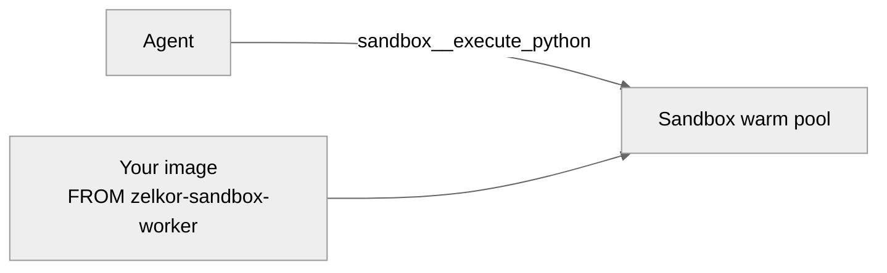

# Sandbox Python with your libraries

## Business case

Generated code in real desks imports more than pandas. A risk helper, a pricing wheel, or `python-dateutil` has to be on the worker before the agent runs. The worker has no outbound network, so `pip install` inside `sandbox__execute_python` hangs or fails.

This example builds a worker image from the stock sandbox image, installs a private package (`desk_risk`) and pinned `python-dateutil==4.0.0` (plus `tzdata==2026.6`), and points the warm pool at that image.

It is not part of the platform install. The stock pool stays pandas and numpy until you apply the overlay.

## What this shows

- **Image, not a runtime install.** Libraries are baked in. The pool is one image for every call.
- **Private code and a PyPI wheel.** `desk_risk` is yours. `python-dateutil` is a third-party pin the stock worker does not ship. [python-dateutil 4.0.0](https://pypi.org/project/python-dateutil/4.0.0/) (2026-11-01) supports Python 3.14.
- **gVisor stays.** The new image still runs as the sandbox worker under RuntimeClass `gvisor`.

## Architecture

The agent never installs packages. It sends code. The worker process imports whatever that image contains.



## Prerequisites

- A running Zelkor release.
- Docker, and permission to push `ghcr.io/devopssquaddev/zelkor-example-sandbox-python` or to load the image onto the cluster nodes.
- Helm access to the platform release.

## Build and point the pool at it

Build from the `zelkor-platform` directory. The base image tag must match the worker you extend (`2.4.2` below).

```bash
IMAGES=zelkor-example-sandbox-python IMAGE_TAG=2.4.2 ./scripts/build-images.sh --push
helm upgrade <platform-release> charts/zelkor-platform \
  --namespace <platform-namespace> \
  --reuse-values \
  -f examples/sandbox-python/values-platform-overlay.yaml
kubectl -n <platform-namespace> rollout status deploy/<platform-release>-mcp-sandbox-worker-0
```

The overlay pins tag `2.4.2`. If your workers use another tag, change `workerImage.tag` in that file before the upgrade.

On a kind cluster that does not pull from GHCR, load the tag into the node after the build (omit `--push`).

```bash
kind load docker-image ghcr.io/devopssquaddev/zelkor-example-sandbox-python:2.4.2 --name <kind-cluster>
```

## Check the import

```bash
kubectl -n <platform-namespace> exec deploy/<platform-release>-mcp-sandbox-worker-0 -- \
  python -c "import desk_risk; from datetime import date; print(desk_risk.herfindahl({'AAPL': 40, 'MSFT': 30, 'GOOGL': 30})); print(desk_risk.next_review(date(2026, 11, 5)))"
```

Stdout is `0.34` and `2027-11-05`. The same import works in `sandbox__execute_python`. Deep Agents pass that program as `execute(command=...)`, not as a `code` argument.

To add another wheel, pin it in `images/example-sandbox-python/requirements.txt` and rebuild. Native wheels must match the worker’s Python (`3.14`). If the process needs more than the worker memory limit (`512Mi`), raise `workspace.tools.sandboxMCP.worker` memory.

## Put the stock image back

`--reuse-values` keeps this repository until you set it back.

```bash
helm upgrade <platform-release> charts/zelkor-platform \
  --namespace <platform-namespace> \
  --reuse-values \
  --set workspace.tools.sandboxMCP.workerImage.repository=ghcr.io/devopssquaddev/zelkor-sandbox-worker \
  --set workspace.tools.sandboxMCP.workerImage.tag=2.4.2
```
